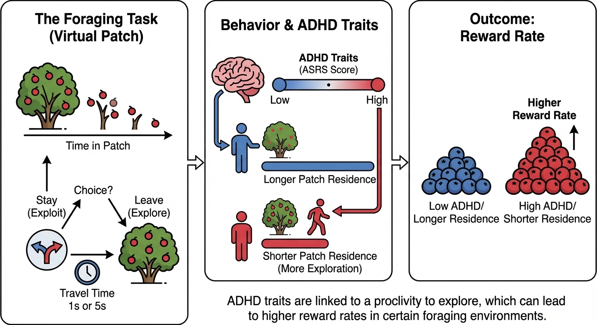

# Attention deficits linked with proclivity to explore while foraging

Data preprocessing and analysis code for the foraging-ADHD study from the Platt Lab.

## Authors

David L. Barack\*, Vera U. Ludwig\*, Felipe Parodi, Nuwar Ahmed, Elizabeth M. Brannon, Arjun Ramakrishnan, Michael L. Platt

\*Co-first authors

## Abstract

All mobile organisms forage for resources, choosing how and when to search for new opportunities by comparing current returns with the average for the environment. In humans, nomadic lifestyles favouring exploration have been associated with genetic mutations implicated in attention deficit hyperactivity disorder (ADHD), inviting the hypothesis that this condition may impact foraging decisions in the general population. Here we tested this pre-registered hypothesis by examining how human participants collected resources in an online foraging task. On every trial, participants chose either to continue to collect rewards from a depleting patch of resources or to replenish the patch. Participants also completed a well-validated ADHD self-report screening assessment at the end of sessions. Participants departed resource patches sooner when travel times between patches were shorter than when they were longer, as predicted by optimal foraging theory. Participants whose scores on the ADHD scale crossed the threshold for a positive screen departed patches significantly sooner than participants who did not meet this criterion. Participants meeting this threshold for ADHD also achieved higher reward rates than individuals who did not. Our findings suggest that ADHD attributes may confer foraging advantages in some environments and invite the possibility that this condition may reflect an adaptation favouring exploration over exploitation.



## Repository Structure

```
├── scripts/                    # Jupyter notebooks for data processing & analysis
│   ├── foraging_preprocessing.ipynb   # fADHD data cleaning (steps 1-3)
│   ├── amplio_processing.ipynb        # AMPLIO study preprocessing
│   ├── methods.ipynb                  # Statistical analysis & figure generation
│   ├── FRGEADHD_fixserialorder.ipynb  # Serial order corrections
│   └── check_work.ipynb               # Data validation/QA
├── docs/                       # Documentation and supplementary materials
├── data/                       # Raw and processed data (not tracked in git)
│   ├── raw/                    # Original datasets
│   └── processed/              # Cleaned datasets at each processing step
├── amplio/                     # AMPLIO study data (not tracked in git)
├── results/                    # Output figures (not tracked in git)
│   └── figures/
├── src/                        # Source code modules
└── tests/                      # Test files
```

## Data Processing Pipeline

### fADHD Study (n=464 final)
1. Load 494 trial datasets matched with survey data
2. Filter to 464 valid participant IDs
3. Remove invalid patches (final bush removed if last decision ≠ explore)

### AMPLIO Study (n=208 final)
1. Convert decisions to binary (0=explore, 1=exploit)
2. Convert timestamps to seconds
3. Remove participants with no exploit decisions (n=23 excluded)
4. Remove final bushes from all blocks
5. Filter to participants with ≥25 total decisions

## Key Variables

| Variable | Description |
|----------|-------------|
| ID | Participant identifier |
| Block | Experimental block (1-4 for fADHD, 1-2 for AMPLIO) |
| Bush | Patch number within block |
| Round | Trial number within patch |
| Decision | 0 = explore (leave patch), 1 = exploit (stay in patch) |
| TotalTime_sec | Cumulative time in seconds |
| RT | Reaction time (ms) |
| BerryCount | Reward obtained |

## Dependencies

- Python 3.x
- pandas
- numpy
- matplotlib

## Data Availability

Raw participant data is not included in this repository. Contact the authors for data access requests.
